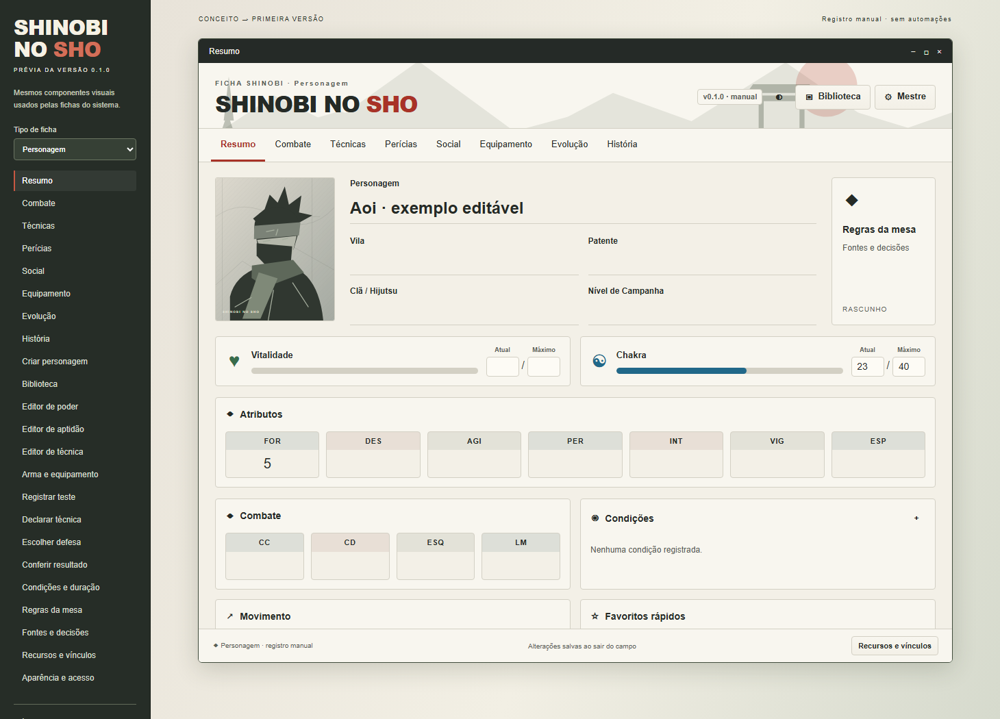

# Shinobi no Sho — Foundry VTT 14

**Versão 0.1.0 · fichas manuais · português brasileiro**

Primeira versão com foco na interface: marfim, grafite, vermelho discreto e leitura clara, seguindo os conceitos visuais preparados para o projeto. Valores e decisões permanecem sob controle da mesa.

Veja as [telas implementadas](docs/INTERFACE.md). Esta é uma versão inicial: código e prévia foram testados; execução dentro de um mundo real do Foundry 14 ainda não foi verificada. Detalhes em [Validação](docs/VALIDACAO.md).



## Instalar pelo Foundry

1. No Foundry 14, abra **Sistemas de Jogo → Instalar Sistema**.
2. Cole este endereço no campo de manifesto:

```text
https://github.com/darkmonsterpro0-droid/shinobi-no-sho/releases/latest/download/system.json
```

3. Instale e crie um mundo escolhendo **Shinobi no Sho**.
4. Crie um personagem pelo diretório de Atores ou pelo assistente **Criar personagem Shinobi**.

O endereço permanece igual nas próximas versões. O manifesto aponta para o ZIP da versão publicada, e **Verificar atualizações** do Foundry poderá encontrar versões novas. Instalação por manifesto não exige cadastro do sistema no catálogo oficial do Foundry.

Também é possível baixar o ZIP em [Releases](https://github.com/darkmonsterpro0-droid/shinobi-no-sho/releases) e extrair seu conteúdo na pasta `Data/systems/shinobi-no-sho` da instalação.

## O que esta versão faz

- Edita e salva fichas de personagem, criatura vinculada e marionete.
- Organiza resumo, combate, técnicas, perícias, social, equipamento, evolução e história.
- Permite criar poderes, aptidões, técnicas, equipamentos e dispositivos, com fonte e notas.
- Oferece busca, favoritos, biblioteca de itens do mundo e o arrastar nativo do Foundry.
- Registra condições, recursos especiais e vínculos manualmente.
- Publica anotações de testes, declarações, defesas e resultados no chat, com visibilidade pública, privada ao mestre ou pessoal.
- Guarda livros, variantes e decisões no perfil do mestre; permite revisar o impacto documental antes de salvar.
- Possui temas marfim e grafite e fichas que se reorganizam em janelas estreitas.

Os campos salvam ao sair deles. Números em branco ainda não foram preenchidos. Patente, NC, precisões, recursos máximos e pontos não são derivados automaticamente. Treinamento é uma anotação; a mesa consulta os requisitos da perícia.

## O que fica manual

Esta versão não rola dados, não calcula fichas, não verifica requisitos de compra, não gasta ações/chakra/itens, não aplica dano, não controla iniciativa, não encerra condições e não transfere recursos entre vínculos. Os botões de combate publicam registros; a mesa faz a resolução e edita as fichas.

Não há compêndios transcritos dos livros. Cadastre o conteúdo utilizado pela sua mesa. Alterar o perfil não converte fichas nem aplica revisões automaticamente. Módulos externos não são exigidos e ainda não possuem adaptadores próprios.

## Acesso e atalhos

As permissões nativas do Foundry controlam as fichas. Só o mestre salva o perfil e decisões do mundo. Cada jogador escolhe seu tema em **Configurações → Configurar definições → Shinobi no Sho**. A mesma seção oferece o menu de regras ao mestre.

Macros opcionais, sem automação de regras:

```js
game.shinobi.createCharacter();
game.shinobi.open("library");
game.shinobi.open("settings");
game.shinobi.open("resources", {actor: canvas.tokens.controlled[0]?.actor});
```

## Desenvolvimento e versões futuras

Não há instalação de dependências para testar ou empacotar. Requer Node.js 22 ou superior.

```sh
node --test tests/*.test.mjs
node scripts/preview-server.mjs
```

A prévia abre em `http://127.0.0.1:4173` e usa os mesmos componentes de layout. Seus dados são locais ao navegador; não é um mundo do Foundry.

Para preparar uma atualização, sempre use **um número maior e ainda não publicado**:

```sh
node scripts/release.mjs --version 0.1.1 --repo darkmonsterpro0-droid/shinobi-no-sho
node --test tests/*.test.mjs
node scripts/release.mjs --check --repo darkmonsterpro0-droid/shinobi-no-sho
```

Atualize `CHANGELOG.md` e `RELEASE-NOTES.md`, revise o pacote, faça commit e envie o código para o GitHub. Com a ferramenta oficial `gh` autenticada e o Git configurado, publique:

```sh
node scripts/publish.mjs
```

O publicador exige uma árvore de trabalho limpa, confere que o commit está no GitHub, executa os testes, confere as versões, cria a tag correspondente e publica `system.json` e ZIP. Recusa sobrescrever versões existentes. Cada download é fixado à sua tag; o manifesto estável acompanha a última release. Não é necessário configurar GitHub Actions.

Veja [AGENTS.md](AGENTS.md) para as instruções permanentes e [docs/VALIDACAO.md](docs/VALIDACAO.md) para a evidência e limites dos testes. A compatibilidade alvo é v14; `verified` só será preenchido após validação numa instalação real dessa versão.

## Créditos

Projeto comunitário independente. Código e SVGs originais sob MIT; direitos dos livros, Naruto e Foundry permanecem com seus titulares. Veja [CREDITS.md](CREDITS.md). Não são distribuídos PDFs, ilustrações dos livros, credenciais ou mundos particulares.
